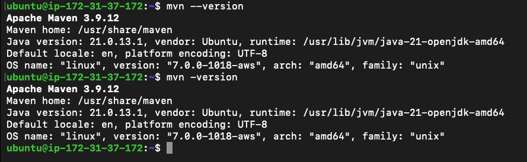
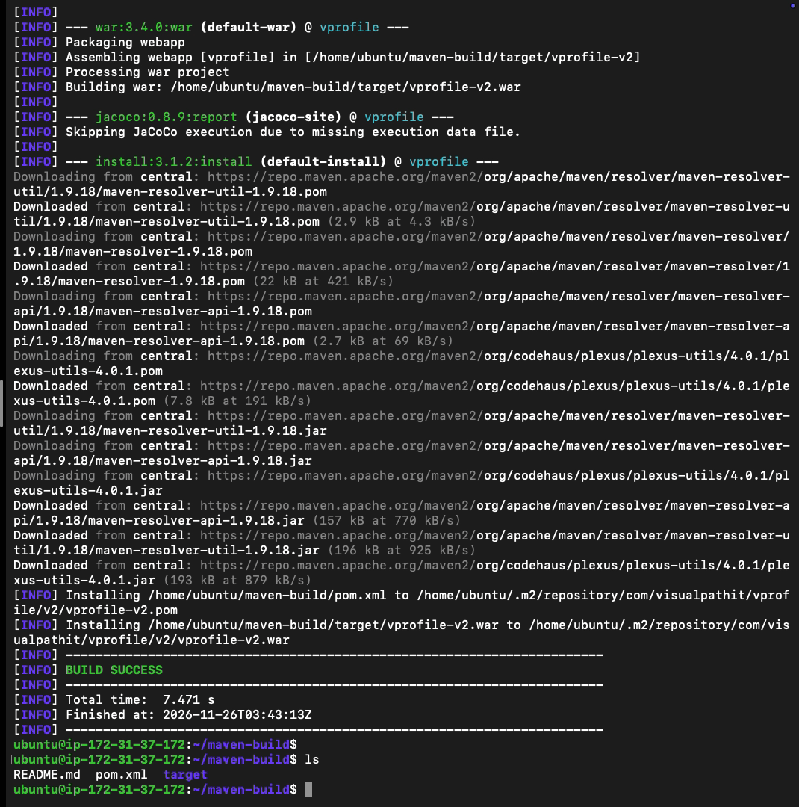
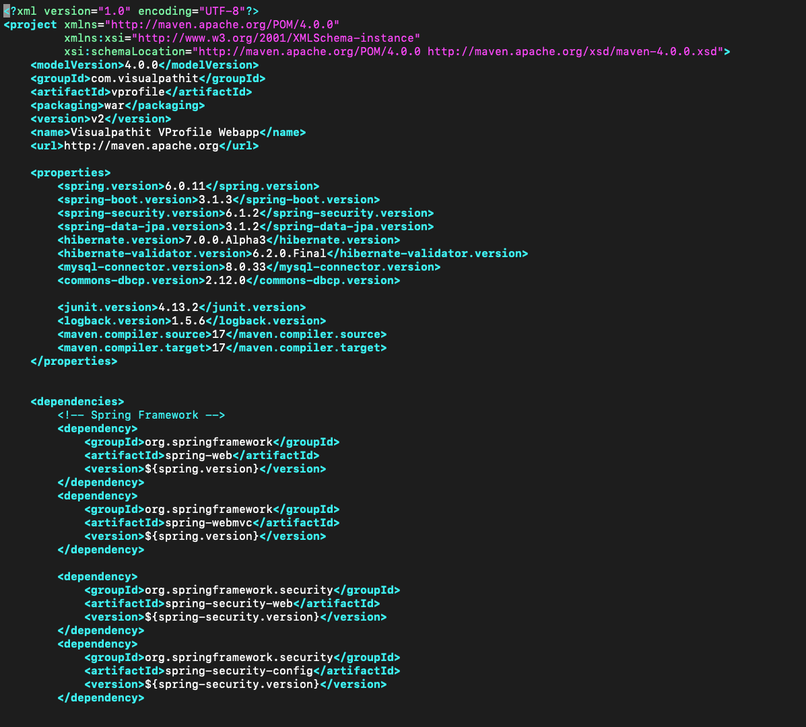

# Java Application Build Automation Using Apache Maven 🚀

## 📌 Project Overview

This project demonstrates the use of **Apache Maven** as a build automation and dependency management tool for Java applications.

The objective is to understand how Maven simplifies the software build process by managing dependencies, compiling source code, executing tests, and packaging applications into deployable artifacts.

Through this hands-on implementation, I explored Maven's project structure, `pom.xml` configuration, build lifecycle, plugins, and WAR packaging.

## 🎯 Project Objectives

- Understand Apache Maven and its role in build automation.
- Configure a Java project using `pom.xml`.
- Manage project dependencies.
- Understand Maven plugins and their functionality.
- Explore the Maven Build Lifecycle.
- Compile and test Java applications.
- Package Java web applications into WAR files.
- Troubleshoot build-related issues.

## 🛠️ Technologies & Tools Used

| Technology | Purpose |
|---|---|
| Java | Application development |
| Apache Maven | Build automation and dependency management |
| XML | Maven project configuration |
| Linux (Ubuntu) | Development environment |
| JVM | Java application execution and memory management |
| Apache Tomcat | Java web application deployment concepts |

## 🏗️ Project Workflow

The project follows a typical Maven build workflow:

1. Create or configure a Java application.
2. Define project configuration in `pom.xml`.
3. Configure dependencies and plugins.
4. Execute Maven build lifecycle commands.
5. Compile Java source code.
6. Execute unit tests.
7. Package the application into a WAR artifact.

## 📂 Understanding pom.xml

The `pom.xml` (Project Object Model) is the central configuration file of a Maven project.

It defines:

- **Group ID:** Identifies the project or organization.
- **Artifact ID:** Identifies the project.
- **Version:** Defines the project version.
- **Dependencies:** External libraries required by the application.
- **Plugins:** Extend Maven build functionality.
- **Packaging:** Defines the output artifact type, such as JAR or WAR.

## 🔄 Maven Build Lifecycle

Explored the important phases of the Maven build lifecycle.

| Phase | Description |
|---|---|
| validate | Validates project configuration |
| compile | Compiles application source code |
| test | Executes unit tests |
| package | Packages compiled code into an artifact |
| verify | Performs verification checks |
| install | Installs the artifact into the local Maven repository |
| deploy | Deploys the artifact to a remote repository |

## 💻 Maven Commands Executed

| Command | Purpose |
|---|---|
| `mvn clean` | Removes previously generated build files |
| `mvn compile` | Compiles Java source code |
| `mvn test` | Executes unit tests |
| `mvn package` | Packages the application |
| `mvn clean package` | Cleans and packages the application |

## 📦 WAR Packaging

As part of this project, I worked with a Java web application and explored WAR (Web Application Archive) packaging.

A WAR file contains the resources and compiled classes required for deploying a Java web application to compatible servlet containers such as Apache Tomcat.

## ⚠️ Challenges & Troubleshooting

### Java Heap Space Error

During WAR packaging, I encountered a Java heap space error.

This helped me understand:

- How Maven build processes use JVM memory.
- How insufficient heap allocation can cause build failures.
- The importance of JVM memory configuration.
- How to investigate and troubleshoot build-related errors.

## 📸 Screenshots & Demonstration

Screenshots and practical demonstrations of the Maven build process are included in this repository.

## Maven Build Process

## Java (JDK)

## WAR Packaging

## POM Configuration 

